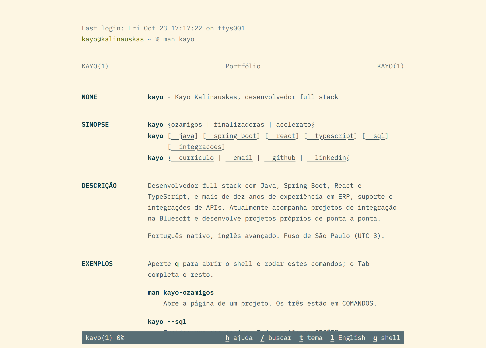

# kalinauskas.dev

[](https://github.com/kayokalinauskas/portfolio/actions/workflows/ci.yml)

Meu portfólio, escrito como uma página de manual do Unix: `man kayo`. Cada projeto é um subcomando com página própria, como no Git (`git log` é documentado em `git-log(1)`), a navegação é a do `less` e o `q` abre um shell que executa os exemplos das páginas.

**[kalinauskas.dev](https://kalinauskas.dev)** · em inglês: **[kalinauskas.dev/en](https://kalinauskas.dev/en)**

<picture>
  <source media="(prefers-color-scheme: dark)" srcset="docs/captura-escuro.png">
  
</picture>

## A ideia

- **Um manual de verdade, não uma fantasia de terminal.** Sem janela falsa, sem tela verde: as seções, a sinopse, as opções e o VEJA TAMBÉM seguem as convenções dos manuais (o HTML do mandoc), e cada título é o link da própria seção.
- **Tudo funciona.** As letras da barra são teclas e botões ao mesmo tempo (`/` busca enquanto você digita, `t` troca o tema, `l` a língua); no shell do `q`, `kayo --sql` explica uma competência, `kayo ozamigos --web` abre o projeto, o Tab completa e o ↑ volta aos comandos anteriores.
- **Legível para quem não usa terminal.** O texto é curto, numa coluna de 66 caracteres, e o currículo, o e-mail, o GitHub e o LinkedIn estão na sinopse, no topo da página.

## Engenharia

- **Estático e rápido.** As oito páginas (quatro em cada língua) são geradas no build; o conteúdo vem no HTML, sem esperar o JavaScript. No Lighthouse: 100 em desempenho, acessibilidade, boas práticas e SEO no computador, e 99 a 100 no celular, com CLS 0 (a fonte de reserva é uma mono com a mesma largura de caractere da IBM Plex Mono).
- **Acessível.** Contraste acima de 4,5:1 nos dois temas, foco visível, botões de 44 px no toque, o nome acessível de cada tecla igual ao texto visível e o realce da busca pela CSS Custom Highlight API, sem mexer no HTML.
- **Conteúdo como dado.** Todo o texto fica em `content/manual.ts`, tipado: a sinopse, a lista de projetos, o VEJA TAMBÉM, o Tab do prompt, o sitemap e uma imagem de prévia por página saem dele.
- **Testado.** Testes de unidade (Vitest) conferem as duas línguas, a marcação e o shell; testes no navegador (Playwright) conferem as páginas no computador e num celular emulado. A CI roda tudo em menos de um minuto a cada push, e o Dependabot cuida das versões.

## Como se usa

| Tecla           | O que faz                                                                                                                                                                                                       |
| --------------- | --------------------------------------------------------------------------------------------------------------------------------------------------------------------------------------------------------------- |
| `j` `k` `↓` `↑` | Rola uma linha                                                                                                                                                                                                  |
| `espaço` `b`    | Rola uma tela                                                                                                                                                                                                   |
| `g` `G`         | Vai ao começo e ao fim                                                                                                                                                                                          |
| `/`             | Busca na página (`n` e `N` para o próximo e o anterior)                                                                                                                                                         |
| `t`             | Troca o tema (Solarized claro ou Tomorrow Night)                                                                                                                                                                |
| `l`             | Troca o idioma (português em `/`, inglês em `/en`)                                                                                                                                                              |
| `h`             | Mostra a ajuda                                                                                                                                                                                                  |
| `q`             | Abre o prompt do shell: `help`, `ls`, `man kayo-ozamigos`, os exemplos das páginas (`kayo ozamigos --web`), `open curriculo.pdf`, `mail`, `theme`, `lang en`. Tab completa e ↑ ↓ voltam aos comandos anteriores |

Cada título de seção é um link para ela (`/#historico`, `/kayo-ozamigos#exemplos`). A barra de baixo mostra as teclas com o que cada uma faz, e cada uma é um botão, para quem usa mouse ou celular.

## Tecnologias

- Next.js 16 (App Router, tudo estático) e React 19
- TypeScript
- CSS Modules; o layout é medido em `ch`, como as colunas de um terminal
- IBM Plex Mono pelo `next/font`
- Busca com a CSS Custom Highlight API, sem mexer no HTML
- Imagem de prévia (Open Graph) gerada no build com `next/og`
- Vercel Analytics

## Como rodar

```bash
npm install
npm run dev
```

```bash
npm run check      # tipos, lint (ESLint com as regras do Next), formatação (Prettier) e testes de unidade
npm run format     # formata tudo com o Prettier
npm run build      # build de produção
npm run test:e2e   # testes no navegador, contra o build (na primeira vez: npx playwright install chromium)
npm run capturas   # refaz as capturas de tela deste README, a partir do build
```

### Testes

- **Unidade** (Vitest, `tests/unidade`): o conteúdo nas duas línguas (as mesmas seções, os mesmos exemplos, referências que existem), a marcação dos textos e o shell do prompt (os comandos, o Tab e o histórico).
- **Navegador** (Playwright, `tests/navegador`): no computador e num celular emulado, as oito páginas abrem, nada passa da largura em 320 px, e a ajuda, a busca e o prompt funcionam.

O GitHub Actions roda tudo isso a cada push e em cada pull request (`.github/workflows/ci.yml`), e o Dependabot abre um pull request quando sai versão nova das dependências. A Vercel publica o `master`. O Node é o 24 (`engines` no `package.json` e `.nvmrc`).

## Onde mexer

| O quê                                                               | Onde                                                               |
| ------------------------------------------------------------------- | ------------------------------------------------------------------ |
| Todo o texto, das quatro páginas e nas duas línguas                 | `content/manual.ts` (a marcação está explicada no topo do arquivo) |
| Os comandos do prompt (`man`, `kayo`, `history`…), o Tab e as setas | `components/sessao/shell.ts`                                       |
| Como uma página de manual é desenhada                               | `components/Manual.tsx` e `components/manual.module.css`           |
| A barra do `less`, as teclas, a busca e a tela do prompt            | `components/Sessao.tsx` e `components/sessao/`                     |
| Cores dos dois temas                                                | `app/globals.css`                                                  |
| Currículo                                                           | `public/curriculo.pdf` e `public/resume.pdf`                       |

### Acrescentar um projeto

1. Ponha o nome em `PROJETOS` (`content/manual.ts`), por exemplo `"kayo-novo"`.
2. Escreva a página em `projetosPt` e em `projetosEn`, com o `resumo` (a linha dele em COMANDOS). O TypeScript não compila sem as duas línguas.

A sinopse da página principal, o item em COMANDOS, o VEJA TAMBÉM das outras páginas, o Tab do prompt, o sitemap, a página e a imagem de prévia saem disso sozinhos. Os testes avisam se as duas línguas ficarem com seções diferentes.

Cada idioma tem o seu layout raiz (`app/(pt)` e `app/(en)`), para o `<html lang>` sair certo. Por isso o 404 ("No manual entry for…") fica em `app/global-not-found.tsx`.

## Licença

MIT. A fonte em `assets/fontes` segue a SIL Open Font License (`assets/fontes/OFL.txt`).
